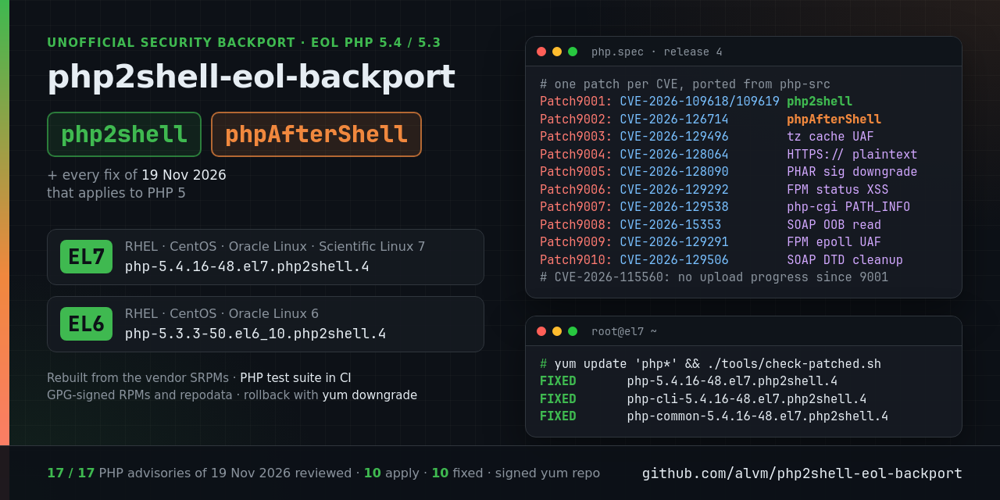

# php2shell-eol-backport



Unofficial backport of the official fixes for **CVE-2026-109618** and **CVE-2026-109619** ("php2shell") and,
since release 2, **CVE-2026-126714** ("phpAfterShell") and, since releases 3 and 4, all other issues of the PHP
security releases of 19 November 2026 that apply to PHP 5 to the end-of-life PHP packages of **Enterprise Linux 6 and 7**:
`php-5.3.3` (RHEL / CentOS / Oracle Linux 6) and `php-5.4.16` (RHEL / CentOS / Oracle Linux / Scientific Linux 7).
Which of these CVEs affect PHP 5 is explained in [How serious is this on PHP 5?](#how-serious-is-this-on-php-5),
[phpAfterShell (CVE-2026-126714) and CVE-2026-115560](#phpaftershell-cve-2026-126714-and-cve-2026-115560) and
[All advisories of 19 November 2026](#all-advisories-of-19-november-2026).

PHP fixed php2shell on 21 Oct 2026 in 8.2.35, 8.3.36, 8.4.27 and 8.5.12, and published source backports for
7.4, 8.0 and 8.1. Nothing was released for PHP 5. Red Hat and Oracle later shipped a fix for CVE-2026-109619 in
PHP 5.4 to their paid RHEL 7 / Oracle Linux 7 extended support customers only, and on 22 Nov 2026 Red Hat
shipped the fixes of 19 Nov for RHEL 7 extended support too; there is no vendor fix for EL6
(see [docs/ALTERNATIVES.md](docs/ALTERNATIVES.md)). If you have to keep such a system running, this project
gives you rebuilt vendor packages with a port of the official minimal fix.

> **This is not an official fix from PHP, Red Hat or Oracle.** It reduces the risk until you can move to a
> supported PHP version — do that as soon as you can.
> On EL8 / EL9 / EL10, install your vendor's updates instead (for example ELSA/RHSA-2026:87080, 87151, 87079).

## What is fixed

- [CVE-2026-109618](https://github.com/php/php-src/security/advisories/GHSA-w8hw-w9fx-j79w) and
  [CVE-2026-109619](https://github.com/php/php-src/security/advisories/GHSA-6wmf-4rv5-p3rp), CVSS 4.0 9.2.
- The patch is a port of php-src commit
  [712e60f9ed](https://github.com/php/php-src/commit/712e60f9edfd03f0960fc4fc3c2c375f42b90aa2)
  ("Avoid state corruption via bailout"), the official minimal backport for PHP 7.4, to the PHP 5.3 / 5.4
  code base. It is applied on top of the vendor package with all its existing security patches.
- Release 2 adds [CVE-2026-126714](https://github.com/php/php-src/security/advisories/GHSA-fm2m-fjf5-v3cp)
  ("phpAfterShell", CVSS 4.0 9.2): a port of php-src commit
  [41c0941ae27](https://github.com/php/php-src/commit/41c0941ae27d1033129e0e09ce3af034ffee86ba)
  ("Fix GHSA-fm2m-fjf5-v3cp: RCE via corrupted session file"), as a second, separate patch.
- Release 3 adds six more issues of 19 November 2026 that apply to PHP 5, one patch each, ported from the
  upstream commits: CVE-2026-129496 (critical, timezone cache use-after-free), CVE-2026-128064 (high, mixed-case
  HTTPS / FTPS URLs sent in plaintext), CVE-2026-128090 (high, PHAR signature downgrade), CVE-2026-129292
  (medium, PHP-FPM status page XSS), CVE-2026-129538 (medium, php-cgi `PATH_INFO`) and CVE-2026-15353 (medium,
  SOAP out-of-bounds read). The full review of all 17 advisories, with the reasons why the others do not apply,
  is in [docs/REVIEW-PHP-2026-11-19.md](docs/REVIEW-PHP-2026-11-19.md).
- Release 4 adds CVE-2026-129291 (high, PHP-FPM epoll use-after-free, php-src
  [13c4db29870](https://github.com/php/php-src/commit/13c4db2987098737278ef78849bb791866021c3c)) and CVE-2026-129506 (medium, SOAP DTD cleanup,
  php-src [13a0f8c8c16](https://github.com/php/php-src/commit/13a0f8c8c1634d80de1a42016390b1bc3bd6e470)). The first review listed both as not
  applicable. Red Hat fixed both in its RHEL 7 update of 22 Nov 2026, so we checked the code again: we were wrong
  about CVE-2026-129291, and for CVE-2026-129506 the fix matters only when PHP loads a WSDL or schema document. See
  [the correction](docs/REVIEW-PHP-2026-11-19.md#correction-in-release-4).
- The patches are made against the vendor source trees. They do not apply to the plain `php-5.4.16` /
  `php-5.3.3` release tarballs, which lack the vendor's later security fixes in the same code
  (for example CVE-2015-4024 in multipart header parsing).

| Distribution | Vendor package | Fixed package from this project |
|---|---|---|
| RHEL / CentOS / Oracle Linux / Scientific Linux 7 | `php-5.4.16-48.el7` | `php-5.4.16-48.el7.php2shell.4` |
| RHEL / CentOS / Oracle Linux 6 | `php-5.3.3-50.el6_10` | `php-5.3.3-50.el6_10.php2shell.4` |

Release 1 (`.php2shell.1`) has the php2shell fix only, release 2 (`.php2shell.2`) adds phpAfterShell, release 3
(`.php2shell.3`) the other fixes of 19 Nov 2026 except CVE-2026-129291 and CVE-2026-129506.

The release suffix sorts above the vendor package, and below vendor errata, so an official fix replaces
this one with a normal update. This now matters on EL7: the extended support updates of Red Hat
(`php-5.4.16-48.el7_9.1` and `…el7_9.2`) and Oracle (`php-5.4.16-48.0.1.el7`) sort above this project's packages.
If your system gets updates from such a channel, `yum update` replaces them with the vendor package. As of
23 Nov 2026, Red Hat's `php-5.4.16-48.el7_9.2` ([RHSA-2026:101337](https://access.redhat.com/errata/RHSA-2026:101337))
fixes the issues of 19 Nov 2026 that apply to PHP 5.4, and Oracle's `php-5.4.16-48.0.1.el7` fixes only
CVE-2026-109619.

### How serious is this on PHP 5?

The two CVEs affect the PHP 5 packages differently (status of 23 Oct 2026):

| | PHP 5.4 (EL7) | PHP 5.3 (EL6) |
|---|---|---|
| CVE-2026-109618 | vulnerable code not present | vulnerable code not present |
| CVE-2026-109619 | **affected** in the default configuration | not affected |

- **CVE-2026-109618.** The memory corruption is in hash table code that was first released in PHP 7.3.0
  (php-src commit 6de54703f). The original report says "PHP 7.2 and earlier do not contain this exact raw-key
  ordering" ([Red Hat Bugzilla 2553995](https://bugzilla.redhat.com/show_bug.cgi?id=2553995), comment 0), and
  PHP 5.3 / 5.4 do not have these functions at all. Red Hat's bulletin
  [RHSB-2026-013](https://access.redhat.com/security/vulnerabilities/RHSB-2026-013) says the same for RHEL 7.
  CrowdStrike's [analysis](https://www.crowdstrike.com/en-us/blog/crowdstrike-protects-customers-from-php-rce-zero-days/)
  gives the same date: this code "first shipped in PHP 7.3.0 (December 2018)".
  An [independent analysis of PHP 5.3](https://github.com/euriconicacio/blog/blob/main/all_collections/_posts/2026-10-22-evaluating-php2shell-reachability-and-corruptibility-in-php-5-3-15.md)
  found that the out-of-memory fault can be reached, but on PHP 5 the known attack ends in a denial of service.
- **CVE-2026-109619.** RHSB-2026-013 (updated on 22 Oct 2026) lists RHEL 7 as "Only affected by
  CVE-2026-109619 — In a default configuration, the version of PHP in use is vulnerable". The known path is
  session upload progress, which PHP 5.4 has (enabled by default) and PHP 5.3 does not. CrowdStrike also
  dates this path back to PHP 5.4. Red Hat's
  [CSAF VEX](https://security.access.redhat.com/data/csaf/v2/vex/2026/cve-2026-109619.json) data agrees that
  RHEL 7 is affected. Red Hat fixed it for RHEL 7 extended support customers on 23 Oct
  ([RHSA-2026:88693](https://access.redhat.com/errata/RHSA-2026:88693)), and Oracle for Oracle Linux 7
  extended support on 29 Oct ([ELSA-2026-88693](https://linux.oracle.com/errata/ELSA-2026-88693.html)).

Red Hat's VEX data also lists RHEL 6 as affected by both CVEs, with the remark "Out of support scope": Red Hat
no longer assesses RHEL 6. The table above for PHP 5.3 follows from the code: it has neither the code of
CVE-2026-109618 nor session upload progress.

Ubuntu lists both CVEs as fixed for its PHP 5.5 package on 14.04
([USN-8948-2](https://ubuntu.com/security/notices/USN-8948-2)). This records which update carries the fix, not
an analysis of the code: Ubuntu lists CVE-2026-109618 as fixed for PHP 7.0 and 7.2 as well, although its code
first shipped in PHP 7.3.0.

So on EL7 the patch matters mainly for CVE-2026-109619: it disables session upload progress in the code. The
rest of the patch, and the whole patch on EL6, is defense in depth: it removes the unsafe error path itself,
in case another way to reach it exists in PHP 5.

If you cannot install a package, `session.upload_progress.enabled = 0` in `php.ini` (not with `ini_set()`),
followed by a restart of every process that runs PHP, closes the known path of CVE-2026-109619.

### phpAfterShell (CVE-2026-126714) and CVE-2026-115560

On 19 Nov 2026 PHP fixed two more session issues in 8.2.36, 8.3.37, 8.4.28 and 8.5.13, both CVSS 4.0 9.2.
There are no official backports for 7.4, 8.0 or 8.1 this time.

| | PHP 5.4 (EL7) | PHP 5.3 (EL6) |
|---|---|---|
| CVE-2026-126714 (phpAfterShell) | affected; fixed in release 2 | affected; fixed in release 2 |
| CVE-2026-115560 | known path closed since release 1 (upload progress disabled) | not affected (no upload progress) |

- **CVE-2026-126714, "phpAfterShell"**, "Partially overwritten session files can lead to remote code execution"
  ([GHSA-fm2m-fjf5-v3cp](https://github.com/php/php-src/security/advisories/GHSA-fm2m-fjf5-v3cp)). The name comes
  from depthfirst, who found the issue ([research](https://depthfirst.com/research/phpaftershell)). The built-in
  `files` session handler rewrote a session file in place and truncated it only when the new data was shorter.
  If such a write is interrupted, the file can keep a mix of old and new session data. PHP says that "the affected
  code has been present since PHP 4.1.0", and the PHP 5.3 / 5.4 vendor code is the same. Exploitation "requires
  attacker influence over the session data, an interruption at a useful point in the write, and an application
  with a suitable deserialization gadget chain." The publicly described attack path gets the data into the
  session through session upload progress, which release 1 already disables on PHP 5.4 and which PHP 5.3 does not
  have. But PHP also notes that disabling upload progress "does not fix applications that independently store
  attacker-controlled session data". Release 2 therefore adds the upstream fix: the session file is always
  truncated before it is written.
- **CVE-2026-115560**, "Session serializer mismatch can lead to remote code execution"
  ([GHSA-658j-r8rw-q6mx](https://github.com/php/php-src/security/advisories/GHSA-658j-r8rw-q6mx)). This is an
  issue of session upload progress, which "was introduced in PHP 5.4.0". Release 1 disables it in the code, so
  this project needs no new change for it. Red Hat's
  [VEX data](https://security.access.redhat.com/data/csaf/v2/vex/2026/cve-2026-115560.json) explains the same
  for its own updates: they "unconditionally disabled the Session Upload Progress functionality", which "provides
  a mitigation for this issue as well".

PHP adds that "other session storage implementations are not affected by this specific file-write defect".

Some reports say that phpAfterShell bypasses the php2shell fix. That refers to the PHP 8.2–8.5 releases of
21 Oct 2026, which fixed php2shell but kept session upload progress enabled by default; depthfirst lists them as
still affected. Release 1 of this project disables session upload progress in PHP 5.4, so the published path,
which needs it, is closed there. Release 2 also fixes the file write itself.

### All advisories of 19 November 2026

PHP published 17 advisories with these releases. We checked each of them against the vendor code of both
packages ([full review](docs/REVIEW-PHP-2026-11-19.md)):

| Result for PHP 5.3 / 5.4 | CVEs |
|---|---|
| fixed in release 2 | CVE-2026-126714 (phpAfterShell) |
| fixed in release 3 | CVE-2026-129496, CVE-2026-128064, CVE-2026-128090, CVE-2026-129292, CVE-2026-129538, CVE-2026-15353 |
| fixed in release 4 | CVE-2026-129291, CVE-2026-129506 (WSDL and schema loading) |
| closed by release 1 (EL7) / not present (EL6) | CVE-2026-115560 |
| not applicable: the code does not exist in PHP 5 | CVE-2026-129289, CVE-2026-129481, CVE-2026-129182, CVE-2026-129474, CVE-2026-127960, CVE-2026-129438, CVE-2026-129501 |

Red Hat's bulletin [RHSB-2026-020](https://access.redhat.com/security/vulnerabilities/RHSB-2026-020) covers the
seven critical ones. Two of them need a closer look on PHP 5:

- **CVE-2026-129496** ([GHSA-gr4f-wgx5-jpfv](https://github.com/php/php-src/security/advisories/GHSA-gr4f-wgx5-jpfv)).
  When PHP writes a diagnostic to a file-based `error_log` during process startup, it can keep a reference to
  a timezone cache in memory that is freed at the end of startup; an early diagnostic of a later request can
  then use the freed memory. PHP says that the affected code "has been present since PHP 5.3.18 and 5.4.8", and
  that "an earlier form of it was present in" 5.3.0 to 5.3.8. The vendor code of both packages has the same
  sequence: the log timestamp is formatted in local time during startup, the startup memory is released, and
  request input is processed before the date extension resets the reference. PHP reports code execution in
  Apache mod_php and PHP-FPM under additional conditions. The trigger needs PHP errors written to a log
  file and a diagnostic during PHP startup; `error_log = syslog` avoids the demonstrated trigger. Release 3 ports
  the upstream fix: outside a started request the log timestamp is in UTC, so the cache is not created then.
- **CVE-2026-129289** ([GHSA-qc49-hpvq-g2w6](https://github.com/php/php-src/security/advisories/GHSA-qc49-hpvq-g2w6)).
  PHP says that the affected code "has been present since PHP 5.6.0", which made reading `php://input` lazy.
  In PHP 5.3 / 5.4, request shutdown always reads and discards a request body that was not read in full, so
  no unread bytes can stay on a FastCGI connection. Red Hat's VEX data lists RHEL 7 as affected; the code does
  not support that, so this project does not change it.

## Install

From the signed yum repository on GitHub Pages:

```bash
# EL7
curl -o /etc/yum.repos.d/php2shell-eol-backport.repo \
  https://alvm.github.io/php2shell-eol-backport/php2shell-eol-backport-el7.repo
# EL6
curl -o /etc/yum.repos.d/php2shell-eol-backport.repo \
  https://alvm.github.io/php2shell-eol-backport/php2shell-eol-backport-el6.repo

yum update 'php*'            # confirm the signing key: fingerprint under "Signing key" below
service httpd restart        # and php-fpm, if you use it
```

The repository contains only the PHP packages of this project, and both the packages and the repository
metadata are signed (`gpgcheck=1`, `repo_gpgcheck=1`). The RPMs and source RPMs are also attached to each
[release](https://github.com/alvm/php2shell-eol-backport/releases), with a signed `SHA256SUMS`; install them
with `yum localinstall`.

To roll back to the vendor packages, run `yum downgrade` for the installed PHP packages and restart the services.
yum needs the vendor version of every installed PHP package: on EL7 some of them, for example `php-fpm`,
`php-mbstring` and `php-mysqlnd`, come from the optional repository (`ol7_optional_latest` on Oracle Linux 7,
`rhel-7-server-optional-rpms` on RHEL 7), which must be enabled for the downgrade.

## Check a system

```bash
sudo ./tools/check-patched.sh
```

It lists every installed PHP 5 package as `FIXED` (latest release), `OUTDATED` (an older release, with the
fixes it lacks) or `VULNERABLE`, and checks that the PHP CLI runs the fixed code. Run as root, it also
lists every running process that still uses the replaced PHP files (mod_php in any httpd instance, php-fpm,
php-cgi, PHP CLI daemons), so you know what to restart. Exit status: 0 fixed, 1 vulnerable, 2 restart needed,
3 older release installed.

## Behaviour changes and known limitations

The fix follows the official minimal backport, which favours safety over graceful error handling:

- **Memory exhaustion ends the PHP process.** When a request exceeds `memory_limit` (or an allocation size
  overflows), PHP prints `Fatal error: ...` to stderr (the web server error log) and the process exits at once.
  Apache / php-fpm start a new worker. Shutdown functions do not run, and temporary files of uploads in that
  request are not removed — `tmpwatch` (EL6) and `systemd-tmpfiles` (EL7) clean them from `/tmp` over time.
- **Session upload progress is disabled** (PHP 5.4; PHP 5.3 does not have it).
- **Session files are always truncated before they are written** (release 2, phpAfterShell fix). If
  truncation fails, PHP logs
  `ftruncate() failed: ...` and the session data of that request is not saved, as in the upstream fix.
- **Error log timestamps outside a request are in UTC** (release 3, CVE-2026-129496 fix). A message that PHP
  writes to a file-based `error_log` during startup or shutdown, outside a started request, shows the time
  in UTC (on EL7 with the `UTC` suffix); messages of requests keep the local time zone, as in the upstream fix.
- **`HTTPS://` and `FTPS://` URLs in any letter case use TLS** (release 3). Before, only lowercase schemes did.
- **A phar is rejected when `<phar>.pubkey` exists but its signature does not use OpenSSL** (release 3), with the
  error "openssl public key found, but the signature does not use openssl".
- **The PHP-FPM status page escapes all request fields** in its HTML and XML output (release 3); the JSON output
  is unchanged.
- **Multipart requests:** only the `Content-Disposition` and `Content-Type` headers of each part are kept
  (the only ones PHP uses), and the new `php.ini` directive `max_multipart_body_parts` limits the number of
  parts (default `-1` = `max_input_vars` + `max_file_uploads`).
- The patch adds one exported function (`zend_mm_safe_error_ex`) and changes no existing API or ABI, so
  extensions built for the vendor package keep working.

This is a minimal mitigation of the published attack paths, not a full security update of PHP 5.

## How it was verified

- Built from the vendor source RPMs (pinned SHA-256 in `build/build.sh`); the spec change is 46 added lines
  and one changed line (`spec/*/php.spec.diff`).
- The PHP test suite (`make test`, run during the RPM build) was compared with an unmodified rebuild of the
  same vendor package. The only new failures are expected:
  the session upload progress tests (feature disabled) and `tests/lang/bug45392.phpt` (the fatal error
  message now starts with an empty line, as in the official 7.4 patch).

  | | tests | failed: vendor | failed: patched |
  |---|---|---|---|
  | EL7, PHP 5.4.16 | 12373 | 14 | 23 (8 upload progress + bug45392) |
  | EL6, PHP 5.3.3 | 11213 | 55 | 56 (bug45392) |

  The exact counts vary slightly between build environments: on GitHub runners two SPL file-owner tests
  (`DirectoryIterator_getOwner/getGroup_basic`) also fail, and `time_sleep_until_basic` is timing-sensitive.
  None of them touches code changed by the patch.

- Release 2 (phpAfterShell fix) has exactly the same failed tests as release 1 on both EL6 and EL7, including
  the session tests. The release 2 binaries (`libphp5.so`, `php`) contain the new code, and the release 1
  binaries do not.

- Release 3 has exactly the same failed tests as release 2 on both EL6 and EL7. In clean containers, an
  update from release 2 to release 3 showed the changed behaviour directly: a PHP startup warning in a file-based
  error log changed from local time to UTC while messages of requests stayed in local time (CVE-2026-129496), a
  request to an `HTTPS://` URL changed from plaintext `GET` to a TLS handshake (CVE-2026-128064), and a SHA1-signed
  phar next to a `.pubkey` file changed from opened to rejected (CVE-2026-128090). The other three fixes were
  checked by code review against the upstream commits and by the test suite.

- Release 4 has exactly the same failed tests as release 3 on both EL6 and EL7. Its two patches are the same lines
  as the upstream commits. In clean containers, after an update from release 3, PHP-FPM with
  `catch_workers_output = yes` kept running through repeated kills of its workers, and `SoapClient` loaded a WSDL
  document with a `DOCTYPE`. These are regression checks of the changed code paths, not tests of the vulnerabilities.

- The PHP 5.4 patch was compared with an independent port of the same fix for Amazon Linux 2's `php-5.4.16`:
  the core changes are identical. The differences are listed in [docs/ALTERNATIVES.md](docs/ALTERNATIVES.md).
- No exploit code was written or used. Please review the patch against the upstream commit yourself.

## Alternatives

- **Commercial:** TuxCare Extended Lifecycle Support shipped php2shell fixes for EL6 and EL7 on 21 Oct 2026.
  Red Hat (RHEL 7 ELS) and Oracle (Oracle Linux 7 Extended Support) fixed CVE-2026-109619 for their extended
  support customers on 23 and 29 Oct.
- **Other free patches:** mostly for the upstream 5.4.45 / 5.3.29 sources, one for Amazon Linux, and source
  patches for the same EL6 / EL7 vendor trees.

See [docs/ALTERNATIVES.md](docs/ALTERNATIVES.md) for the vendor status, a list of projects and a comparison.

## Build it yourself

Requires Docker and about 3 GB of free disk space per build.

```bash
build/build.sh el7      # results in _build/el7/RPMS
build/build.sh el6      # results in _build/el6/RPMS
```

The script downloads the vendor source RPM, checks its SHA-256, and rebuilds it in a pinned Oracle Linux
container with the spec file and patch from this repository.

## Signing key

Packages and release tags are signed with:

```
pub   rsa4096/80797C97A561BC94 2026-10-22 [SC] [expires: 2029-10-21]
      2757 B60F D23D ED25 021B  BE37 8079 7C97 A561 BC94
uid   Oleksii Molchanov (php2shell-eol-backport signing key) <2106429+alvm@users.noreply.github.com>
```

The key is in this repository (`RPM-GPG-KEY-php2shell-eol-backport`) and on `keyserver.ubuntu.com`.

## Repository layout

```
patches/el7, patches/el6   the fixes, as patches against the vendor source tree (one per fix)
spec/el7, spec/el6         vendor spec files with the patch added, and their diffs
build/                     reproducible container build
tools/check-patched.sh     check an installed system
docs/ALTERNATIVES.md       vendor status, other projects, comparison
docs/REVIEW-PHP-2026-11-19.md  review of all PHP advisories of 19 November 2026 for PHP 5
docs/social-preview/       the GitHub social preview image and its HTML source
SECURITY.md                how to report a security problem
```

## Reporting problems

Open an issue for bugs. For a security problem in the patch itself, see [SECURITY.md](SECURITY.md).

## Credits and license

- The fixes are by the PHP project; this project only ports them. See the GitHub advisories for the
  reporters.
- Patches: PHP License 3.01 (`LICENSE.PHP`), like the code they change. Build scripts and tools: MIT
  (`LICENSE`). Spec files are derived from the Red Hat / Fedora packaging (MIT).
